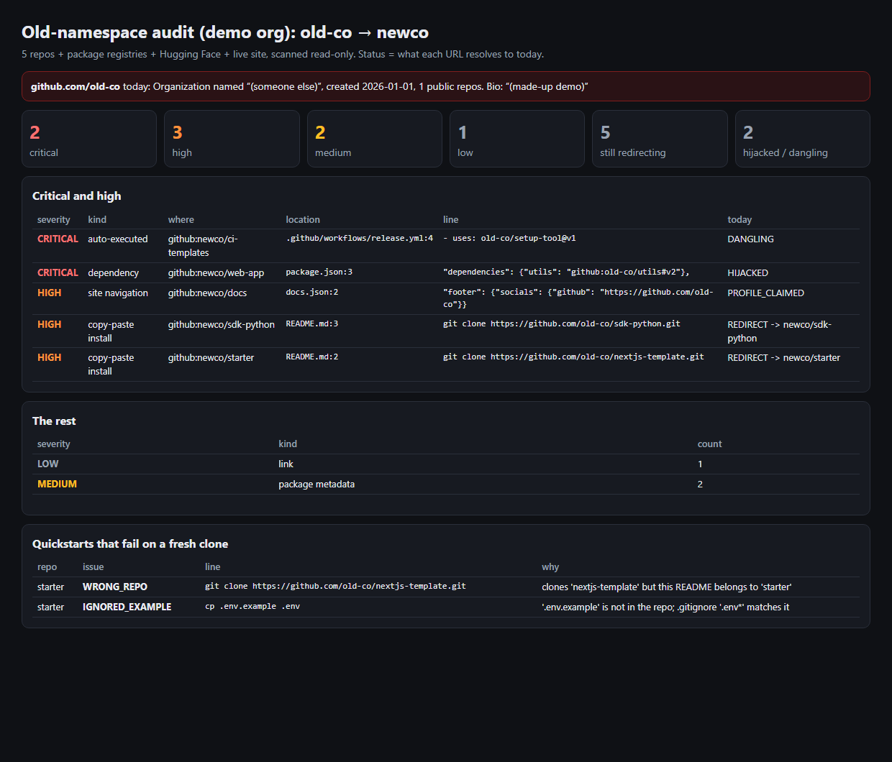

# repojack: audit and fix links to a GitHub name you no longer own

When a GitHub organization is renamed, old URLs keep redirecting only until someone else takes the old name. GitHub's docs: "your old organization name becomes available for someone else to claim", and "the new organization owner can create repositories that override the redirect entries to your repository" ([Renaming an organization](https://docs.github.com/en/organizations/managing-organization-settings/renaming-an-organization)).

From then on, any of these can quietly serve someone else's code or page:
- a `git clone` in a README
- a `uses:` in a workflow
- a `github:` dependency
- a PyPI or npm "Repository" link
- a "GitHub" icon in a site footer

`repojack` finds every one of them, checks what each URL resolves to **today**, ranks them by how they're used, and writes the fix.

I built it while looking at Interfaze's rename (JigsawStack → InterfazeAI). The Interfaze-specific results went to their team privately. Five small fix branches are ready on my forks. This repo ships the tool and a demo on a made-up org.



## What it does

| Step | How |
|---|---|
| **Scan** (read-only) | Every public repo of the org (shallow clones, skipping `node_modules`/builds); npm and PyPI metadata (repository, homepage, bugs, project URLs) weighted by last month's downloads; Hugging Face model, dataset and Space cards plus `requirements.txt`/`app.py`; pages of the live site. Case-insensitive, with a name boundary, so `old-co` doesn't match `old-coders`. |
| **Resolve** | One `HEAD` per referenced URL: **REDIRECT → owner/repo** (safe until someone creates that name), **HIJACKED** (a real repo is already there), **DANGLING** (404: claimable now, no redirect to beat), **PROFILE_CLAIMED** (bare profile links already show the new holder). It also records who holds the old name now. |
| **Rank** | **CRITICAL:** run automatically (`uses:` actions, submodules, `github:`/`git+` dependencies, piped `raw.githubusercontent.com` scripts). **HIGH:** copy-paste installs (`git clone`, `pip install git+`) and site navigation. **MEDIUM:** package metadata shown on registries. **LOW:** links and badges. |
| **Fix** | Rewrites each URL to its **live redirect target**, so a renamed repo lands right (`nextjs-template` → `starter`) and the following `cd` is fixed too. Hijacked or dangling URLs are **not** rewritten; they're listed for a person. One patch per repo. |
| **Quickstart lint** | Do README commands work on a fresh clone? Catches a wrong repo being cloned, a `cd` that doesn't match the clone folder, and `cp .env.example .env` when the file is missing or swallowed by `.gitignore` (`.env*`). |

## Results

**Demo** (`python demo.py`, made-up org, offline): 8 references across 5 repos.
- **2 CRITICAL:** a workflow `uses:` an action that's dangling, and a `github:` dependency that's already hijacked. Both are left for a person.
- **3 HIGH:** a footer link to the claimed profile, and 2 clone commands.
- **2 MEDIUM, 1 LOW.**
- **Quickstart lint:** the `.env*` / `.env.example` bug and the wrong clone.

**Real run on Interfaze** (shared privately), in summary:
- **59 references:** 11 high, 26 medium, 22 low, 0 critical. Every repo URL was still redirecting.
- Package metadata on two registry packages with about 91K and 36K downloads a month.
- 1 broken quickstart, caught by the lint and fixed in a branch.

**Bug the tests caught in the tool itself:** without a name boundary, `JigsawStack` also matched `jigsawstackers`. It's fixed and covered by a test.

## Run

```bash
python demo.py                          # offline demo → out/report.html, out/patches/
python -m pytest -q                     # 7 tests (stdlib only; pytest to run them)
python -m repojack.cli --org NewOrg --old OldName --npm pkg --pypi pkg --hf hf-user --site https://example.com
```

The CLI needs `gh` (authenticated) and `git`. It only reads: clones, registry JSON, one `HEAD` per URL.

## Honest limits

- **It can't see private repos or other people's copies.** Forks, blog posts and Stack Overflow answers that use the old name stay out of reach. Only GitHub can retire a name.
- **GitHub permanently retires old names** for repos that had over 100 clones (or Marketplace actions) in the week before a rename. The tool can't know whether that happened, so it treats every redirect as claimable.
- **Severity comes from context heuristics** (file type, command on the line). Unusual layouts can be mislabelled; each line is in the report for review.
- **Registry metadata needs a new release** to change. The tool writes the source fix, not the release.

Unofficial prototype by Kushagra Pratap Singh. Not affiliated with Interfaze.
